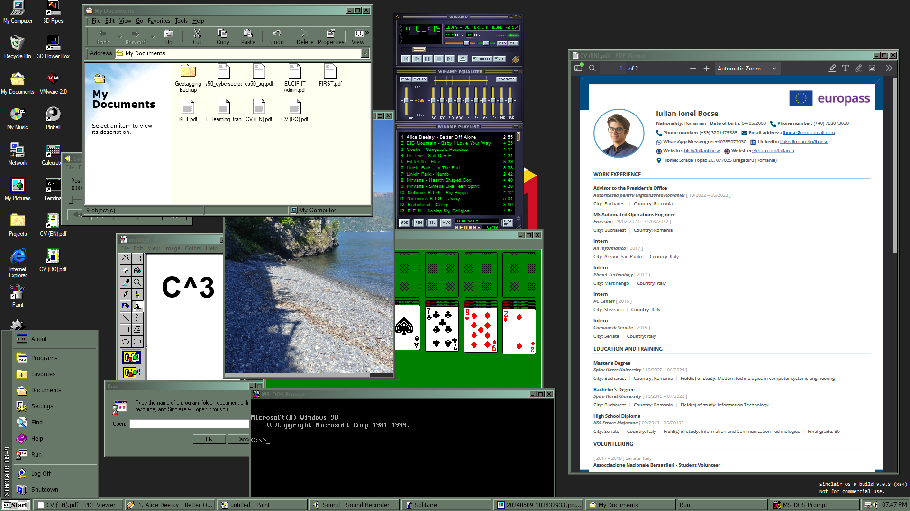

# ibocse

A web-OS  built on top of [98.js](https://github.com/1j01/98).

This project was made with the intention of being my profile/presentation/cv on my website.

## Features

Most of the original 98.js features were kept as they were or slightly modified to better suit this project.
To read more about them, refer to the original [98.js README](https://github.com/1j01/98/blob/master/README.md#-98js).

As far as features that were added by me:

*  [NetLogin](https://github.com/iulian-b/ibocse/tree/main/programs/netlogin): used to authenticate when accesing network endpoints in `/Networks` (it's all fake, there's nothing there to access, but it adds a touch of *immersiveness*)
*  [PdfViewer](https://github.com/iulian-b/ibocse/tree/main/programs/pdfviewer): Used to view `.pdf` files
*  [PicView](https://github.com/iulian-b/ibocse/tree/main/programs/picview): Used to view `.png`, `.jpg`, `.gif`, and `.bmp` files
* [MDView](https://github.com/iulian-b/ibocse/tree/main/programs/mdview): Used to view `.md` (Markdown) files
*  [Run](https://github.com/iulian-b/ibocse/tree/main/programs/run): A recreation of the Windows 98 [Run dialog](https://perishablepress.com/wp/wp-content/images/2007/misc-chunks/run-command.png)
*  [VMware](https://github.com/iulian-b/ibocse/tree/main/programs/vmware): A fake virtualization software (!no affiliation with VMware LLC!). It is basically just a stripped-down 98.js Explorer that opens on the webiste itself
*  Panic: a fake Kernel Panic screen Easter egg
*  [Bootloader](https://github.com/iulian-b/ibocse/blob/main/src/%24bootloader.js): A fake Linux-style bootstrap sequence which runs on the first visit
*  [BIOS](https://github.com/iulian-b/ibocse/tree/main/BIOS): ... BootMenu, and a POST screen too! Just please do not change the stored BIOS config, i am tired of prying the cr2302 out every time
*  [Icons](https://github.com/iulian-b/ibocse/tree/main/images/icons): Changed and added a bunch of W98 inspired icons. [win98icons]([https://](https://win98icons.alexmeub.com/)) and [React95](https://github.com/React95/React95/tree/master/packages/icons) were used whenever i had the chance, as they are both great repositories, while other were made manually.
*  [Start Menu](https://github.com/iulian-b/ibocse/blob/main/src/%24start-menu.js): Finished the start menu that was left unfinished in 98.js, adding an About dialog, shortcuts to various directories,  Log-Off and Shutdown features
*  [Sounds](https://github.com/iulian-b/ibocse/tree/main/audio): Added some sounds (boot, desktop, shutdown)
*  [Games](https://emupedia.net/beta/emuos/): Got some games from EmuPedia. Enjoy playing quake at 15fps in a window in a browser in a window
* Changes to the way the directory tree works
* Now runs with _vite_ instead of _live-server_
* Some other minor fixes and changes that i can't recall...

## Development

Requires Node.js 22.12 or newer.

* `npm install`, then `npm start` runs the site at http://localhost:1998
* `npm run build` puts the deployable site in `dist/`: plain static files that any static host can serve (see [scripts/build.js](scripts/build.js))
* `npm run preview` serves `dist/` the way a static host would
* `npm test` builds the site and runs the [Playwright](https://playwright.dev) tests against it in Chromium, Firefox and WebKit, on port 1999 so it can run alongside `npm start` (the first time, run `npx playwright install`)
* `npm run pull-libs` copies the libraries the site ships (jQuery, jQuery UI, Webamp, Butterchurn, FileSaver.js, ...) from `node_modules` into the site after updating them with npm, and bundles ZenFS into `lib/zenfs.js`. CI fails if they're out of sync with `package.json`.

### The C: drive

The desktop's C: drive is the [C/](C/) folder: `C/My Documents` is `C:\My Documents`, and so on. To put files on the drive, copy them into `C/`:

* with `npm start`, they're there the next time you reload the page
* `npm run build` puts them in `dist/` along with everything else

Nothing needs updating by hand: the list of files the desktop reads, `filesystem-index.json`, is made from `C/` by [scripts/filesystem-index.js](scripts/filesystem-index.js) (on every request with `npm start`, and into `dist/` by the build; `npm run make-fs-index` writes one next to `C/` for any other server). File names can't contain `#`, `?`, `%` or `\`, since the files are downloaded by their URL; the script leaves those out and says so. Hidden files (starting with `.`, like the `.gitkeep` files that keep empty folders in git), `desktop.ini` and `Thumbs.db` are left out too.

The filesystem itself is [ZenFS](https://github.com/zen-fs/core): files are downloaded from `C/` only when they're opened, and anything a visitor saves, changes or deletes is kept in their browser (IndexedDB, plus a list of deleted files in localStorage). The desktop runs it, and the programs in its windows use it through a `MessagePort`, so they all see the same files (see [src/filesystem-setup.js](src/filesystem-setup.js)).

[//]: # (## Demo)

[//]: # ()
[//]: # (You can view a live demo at my [website]&#40;https://ibocse.info&#41;.)

[//]: # (In case something goes wrong ~~&#40;as intended&#41;~~, clear Local Storage on your browser and refresh the page.)

## TODO

* Add Desktop Login screen, with maybe a second "desktop" to choose from
* Add some stuff if `/Favorites/`
* StartMenu - Find
* StartMenu - Settings
* A Video Player: 98.js's README mentioned [win-95-media-player](https://benwiley4000.github.io/win95-media-player/), but i remain open to other options.
* Extend Picview and PDFview with Filepicker dialogs (see notepad.exe filesystem thing)
* Clean up all of the unused stuff from 98.js (as in not used by me)
* Add digitalis

## Credits and Licence

Credits for all of the 98.js elements goes to [Isaiah Odhner](https://github.com/1j01) a.k.a. *1j01*.

As far as licensing goes, [98.js' licence](https://github.com/1j01/98/tree/master?tab=readme-ov-file#license) is:

> Not yet licensed. This project is currently [source-available / shared source](https://en.wikipedia.org/wiki/Source-available_software) but not [open source](https://en.wikipedia.org/wiki/Open-source_software).

So this project shall stay the same, as i do not want to infringe on the right of the original owner.

The C: drive runs on [ZenFS](https://github.com/zen-fs/core) ([@zenfs/core](https://www.npmjs.com/package/@zenfs/core) and [@zenfs/dom](https://www.npmjs.com/package/@zenfs/dom), LGPL-3.0-or-later), bundled unmodified into `lib/zenfs.js` by `npm run pull-libs` (rebuild it from the versions in `package.json` to replace it).

Credits to [kristopolous](https://github.com/kristopolous) for the Bootstrap BIOS-esque theme https://github.com/kristopolous/BOOTSTRA.386 (Apache 2.0) used in my BIOS/BootMenu pages.
